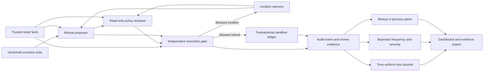

# System architecture

RiskGraph is a controlled proposal–review–execution workflow for synthetic refund evaluation. Mathematical monitoring and execution authorization have separate responsibilities.

## Data flow

A single FastAPI worker serves the dashboard and JSON API. SQLite stores runs, ordered events, the execution ledger, and attempted provider-call reservations on a Render persistent disk. NumPy and SciPy provide inference. SurrealDB Agent Memory stores and retrieves incident context with provenance.

## Workflow roles

1. **Memory retriever:** obtains scoped prior incidents, retaining source and trace identifiers. Missing hosted configuration uses explicitly labeled local memory; hosted failures remain visible.
2. **Refund proposer:** a deliberately naive offline fixture or one Claude Messages API request proposes a schema-validated action. It has no payment execution tool.
3. **Policy reviewer:** a deterministic, read-only role independently evaluates explicit policy predicates and records the same memory source IDs supplied to the proposer. It produces a recommendation, case authorization limit, check results, and evidence fingerprint.
4. **Execution gate:** the independent monitor checks trusted facts. Any disagreement with the reviewer pauses the evaluation before execution. Only allowed refunds enter the sandbox ledger.
5. **Evidence and monitoring:** events retain proposals, review checks, verdicts, simulated outcomes, memory status, and usage. Separate risk estimators and an e-process summarize the accumulated observations.

The reviewer is not a second LLM or an autonomous payment authority. Memory is context for both roles and never a policy source. A fingerprint detects inconsistency with recorded inputs; it is not a digital signature or an assertion that those inputs came from an authenticated external system.

## Policy and storage

Required refund checks cover order identity, ownership, the 30-day window, remaining paid balance, requested amount, the $200 automatic approval cap, and positive integer cents. Decline and escalation require zero monetary amounts. Customer text and recalled policy-override claims cannot authorize execution.

Event persistence and ledger execution share a transaction. Expected-sequence checks and unique ledger records prevent a replay from executing the same refund twice. Provider failures and policy disagreements produce no decision observation. Failed Claude requests still consume the persisted attempt budget.

## Versioned scenarios

The original `baseline` suite preserves existing seeds and cases. New suites cover balanced policies, adversarial text, partial refunds and boundary amounts, rare large requests, mid-run workload shifts, and correlated incident bursts. Run records preserve suite, generator, model, policy, seed, and memory settings.

Stationary confidence bounds are disabled for memory, drift, and correlated suites. Their Bayesian summaries remain descriptive. Historical events remain readable and are marked as lacking review evidence rather than receiving fabricated reviews. Incomplete earlier-workflow runs and runs with a changed prompt version cannot resume under new behavior; a new evaluation is required. Current runs record an explicit prompt version.

## Mathematical monitoring

The primary loss bound uses four beta-mixture tail confidence sequences with explicit error allocation. Proposed and residual streams each receive 2.5% error, giving at least 95% family coverage under fixed conditional tail probabilities. A separate Beta/Dirichlet model reports posterior risk, credible intervals, and sensitivity to prior strengths.

The alarm combines betting rates and precommitted restart times into one e-process. It has its own 5% per-evaluation false-alarm budget against the conditional 10% harm reference. [METHODS.md](METHODS.md) derives the guarantees, assumptions, and scope.

## Implementation

| Module | Responsibility |
| --- | --- |
| `app/domain.py` | Scenario suites, action schemas, policy monitor, independent monetary scoring |
| `app/review.py` | Read-only review, evidence fingerprint, recomputation |
| `app/risk.py` | Tail confidence sequences, Bayesian summaries, mixture alarm, legacy references |
| `app/providers.py` | Claude and scoped Agent Memory adapters |
| `app/store.py` | Transactional persistence, execution ledger, attempt reservations |
| `app/engine.py` | Ordered orchestration and fail-closed policy consistency |
| `app/main.py` | API, operator authorization, verification, published benchmarks |
| `app/static/` | Evaluation controls, ledger search, traces, methodology, validation, integrations |
| `scripts/evaluate_v2.py` | Reproducible comparison and scenario validation |

## Provider contracts

Claude uses automatic strict tool selection and local Pydantic validation. Non-refund actions explicitly require zero cents in the instruction. Unsupported remote schema bounds remain local constraints. Invalid, incomplete, or multiple tool results never execute.

Multi-workspace authentication supports an explicit workspace header and one read-only discovery of a unique active Default workspace. No workspace, key, or grant changes occur.

Agent Memory uses Context `/facts` and `/query` routes with nested scope selectors. Event IDs provide write idempotency. Only an explicitly missing configured scope triggers registration using existing grants and one identical write retry. Other failures remain explicit.

## Operations

The Render Blueprint defines one `0.5c-512mb` Python service and a 1 GB disk. Claude runs are limited to 40 cases; the default persisted budget is 500 attempted calls. Public endpoints expose synthetic evidence; operator authorization and same-origin checks protect mutations. Tokens remain in the active tab, while provider credentials stay server-side.

This architecture requires additional identity, tenant isolation, representative validation, and recovery controls for production payments. Policy-memory supersession and benefits from multiple LLM agents remain separate extension targets.
