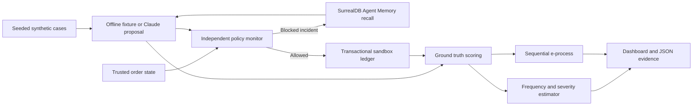

# System architecture

RiskGraph combines pre-execution policy enforcement, low-sample monetary risk estimates, and incident provenance in a synthetic refund workflow.

## Data flow

A FastAPI process serves the dashboard and JSON API. NumPy and SciPy provide posterior inference. SQLite stores evaluations, decisions, execution records, and provider-attempt reservations. Render supplies the persistent disk. SurrealDB Agent Memory provides the incident-memory tier, including retrieval traces and extracted facts.

## Components

| Module | Responsibility |
| --- | --- |
| `app/domain.py` | Seeded scenarios, strict action schemas, policy monitor, independent loss scoring |
| `app/risk.py` | Frequency/severity posterior, interval simulation, sequential upper bound, e-process |
| `app/providers.py` | Claude Messages API and Agent Memory REST adapters |
| `app/store.py` | Evaluation/event/ledger transactions and persisted attempt budget |
| `app/engine.py` | Ordered orchestration, provider errors, memory provenance |
| `app/main.py` | API, operator verification, same-origin mutation checks, public synthetic reads |
| `app/static/` | Overview, decision ledger, methodology, connections, export controls |
| `tests/` | Policy invariants, numerical checks, trajectory simulations, provider contracts, API flows |

## Authorization and execution

Authenticated customer identity and trusted order facts come from the synthetic scenario. Customer text, model explanations, and recalled incidents cannot override policy. The model receives a proposal tool and has no payment-execution tool.

Every proposal passes local schema validation and independent checks for order identity, ownership, refund age, remaining balance, requested amount, and the automatic approval cap. Non-refund actions must carry a zero monetary amount. Only allowed refunds enter the sandbox ledger. Event insertion and ledger writes share a transaction; sequence checks and unique ledger entries prevent duplicate execution.

## Risk and monitoring

Proposed loss measures exposure before the monitor; residual loss measures unauthorized loss after execution. The Bayesian model separates harmful-proposal frequency from positive-loss severity. Its priors and bin endpoints are explicit, and zero observed harm retains uncertainty.

A separate Hoeffding-based time-uniform upper bound applies under bounded, common-mean assumptions. Adaptive-memory runs disable that bound. A betting e-process tracks proposed harm against a fixed 10% reference rate. Full definitions and guarantees are documented in [METHODS.md](METHODS.md).

## Provider contracts

Claude uses automatic strict tool selection, `between_tools`, and low effort. Unsupported remote schema bounds are expressed in descriptions and enforced by the complete local Pydantic model. Exactly one valid `propose_refund` result is required. Invalid or failed responses produce no observation or execution.

Workspace selection uses an explicit `ANTHROPIC_WORKSPACE_ID` when configured. Otherwise, one read-only lookup per process can select a uniquely identified active Default workspace from a complete response. Lookup denial does not change permissions or create workspaces.

Agent Memory writes blocked incidents through `/facts` and retrieves prior context through `/query`. Event IDs supply write idempotency. Scope selectors, source IDs, retrieval trace IDs, and memory turn IDs are retained. An explicitly missing configured scope can be registered using existing grants, followed by one identical idempotent write retry. Other failures remain visible.

## Deployment and resource boundaries

The application uses one Python worker and one persistent SQLite database. The current workspace supports up to 30 runs. Claude evaluations allow 40 cases per run, a 700-output-token request ceiling, and a persisted 200-attempt budget by default. Failed calls consume attempts; automatic model retries are disabled.

The Render Blueprint specifies a `0.5c-512mb` web service and a 1 GB disk mounted at `/var/data`. Credentials are server-side configuration. The operator token protects evaluation mutations; public endpoints expose synthetic evidence. This single-instance evaluation architecture requires additional authorization, storage, and recovery controls before production use.

## Extension points

A risk-review agent could share incident evidence with the refund agent, while versioned policy facts could demonstrate typed, time-aware supersession and source tracing. These capabilities are future extensions. Trusted authorization remains independent of recalled text.

Further verification can add independently checked authorization evidence and bounded arithmetic policy-model proofs. Current validation covers tested policy invariants and provider contracts; it does not constitute an end-to-end proof of an AI system.
