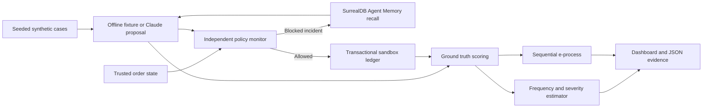

# RiskGraph architecture and implementation plan

Prepared October 18, 2026. Submission target October 25, 2026, 11:59 p.m. America/Toronto.

## Product and scope

For a support operations lead evaluating an AI refund agent: show how often it proposes harmful actions, how costly those actions could be, what the independent monitor prevents, and how uncertain estimates remain with little evidence. This MVP operates on synthetic orders and simulated dollars only.

## System

One FastAPI process serves an HTML/CSS/JavaScript dashboard and JSON API. NumPy/SciPy provide posterior inference. SQLite stores ordered decisions and the execution ledger, with a Render persistent disk. This is an appropriate single-instance MVP, with 30 runs maximum per workspace. It is not a horizontally scaled payment service. SurrealDB Agent Memory is the incident memory tier; its extracted graph and retrieval traces complement the exact local audit records.

Trusted boundaries: authenticated customer identity and order facts come from the synthetic world. Customer messages, model reasons, and recalled incidents cannot override policy. Agent tool inputs are strictly validated. The model never gets a payment-execution tool. Policy checks gate every simulated refund. Event insertion and ledger writes share one transaction. Sequence checks and a uniqueness constraint prevent replays from executing a refund twice.

## Implemented modules

- `app/domain.py`: seeded cases, strict proposals, independent monitor, ground-truth scoring.
- `app/risk.py`: frequency/severity posterior, interval simulation, time-uniform bound, e-process.
- `app/providers.py`: Claude Messages tool proposal and SurrealDB Agent Memory REST adapters.
- `app/store.py`: durable run/event/ledger transactions and persisted Claude attempt budget.
- `app/engine.py`: one-case orchestration, explicit provider errors, memory provenance.
- `app/main.py`: API, same-origin mutations, optional operator token, public synthetic reads.
- `app/static/`: responsive dashboard, run controls, inspection, methods, connections, export.
- `tests/`: policy invariants, numerical checks, simulated coverage, HTTP contracts, API flows.
- `render.yaml`, `Dockerfile`, GitHub Actions workflow: deployment and checks.

## Delivery sequence

| Toronto date | Work | Exit evidence |
| --- | --- | --- |
| Oct 18 | Implement local vertical slice and full offline demo | Automated tests, browser checks, reproducible JSON |
| Oct 19 | GitHub repository and Render/SurrealDB account setup | Public source and provisioned accounts; credits visible |
| Oct 19–20 | Connect Claude; evaluate fixed seeds before credit expiry | Raw API-run exports, usage counts, provider/model identifiers |
| Oct 20 | Connect Agent Memory and compare memory off/on with separate seeds | Successful remember/recall traces, observed decision changes |
| Oct 21–23 | Deploy on Render; smoke test restart persistence and operator access | Actual live URL and health response |
| Oct 24 | Record up to four-minute demo; revise submission with measured results | Public video, write-up, limitations, disclosure |
| Oct 25 | Final submission before 11:59 p.m. ET | Devpost page with public repo and live link |

No ongoing scheduled work has been created. These are milestones, not a claim that later work has happened. The user's Anthropic credit expiry is October 21; the exact time and usable balance must be checked in their console. Finish paid evaluation by October 20 if possible.

## Resource plan

- No Mila cluster, GPU, model training, Node installation, or Kubernetes needed. The agent uses Anthropic's API; the host serves a small Python service.
- Anthropic: one request per case, 700 output-token maximum, 40 cases/run, 200 attempted calls per database by default, no automatic retries. Set provider-console spending controls as well. The attempt count is not a dollar balance and cannot account for other applications sharing the API key.
- Render: one `0.5c-512mb` web service and 1 GB persistent disk. Redeem the $50 before deploying, review the displayed service and disk price, and check remaining credits. Do not assume a monthly spending cap or unlimited hosting.
- SurrealDB: redeem BUILDNORTH50, then provision the Agent Memory Context and narrowly scoped read/write key. Only enable memory during deliberate comparison runs. Memory extraction and recall may consume credits separately from Anthropic.
- Eon Era: optional until account access and its hackathon setup guide are available. Local synthetic evaluation is not claimed as an Era integration.

## Deployment status boundary

Local implementation can be tested without accounts. Actual publication requires a GitHub repository and authorized Render account. Claude live verification requires the user's key configured outside chat. Hosted Agent Memory verification requires a Context endpoint, Context ID, scope, and key. No simulated test result is presented as a successful call to an unconfigured sponsor.

## Sponsor pack follow-up

The participant supplied the complete SurrealDB pack after the initial implementation. Its prize emphasis adds clear targets: superseding typed/time-aware facts, source-traceable retrieval, and coherent memory shared across more than one agent. Next-stage application work should add a risk-review agent sharing incident evidence with the refund agent, plus a versioned synthetic policy-fact demonstration with trace inspection. These are application roles; no claim of an implemented second agent or demonstrated hosted supersession is made in the current MVP. Trusted refund authorization must continue to use the independent policy monitor rather than recalled text.
