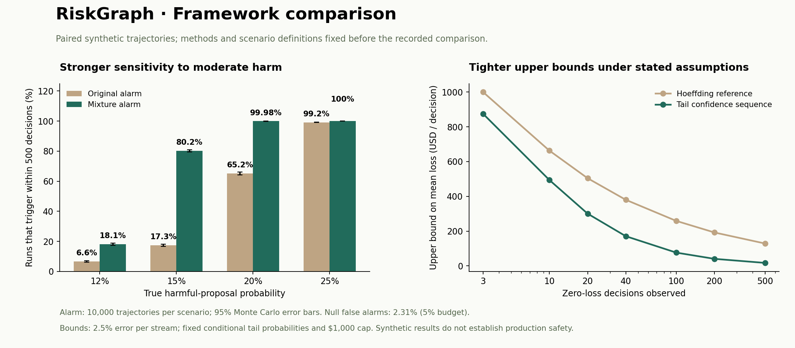

# Framework v2: mathematical and workflow evaluation

## Result

The upgraded framework combines beta-mixture loss-tail confidence sequences, a multi-rate restart-mixture alarm, versioned stress scenarios, and a proposal–review–execution workflow. The primary dashboard displays statistically valid upper bounds separately from Bayesian estimates.

At 15% harmful proposals, the alarm triggered within 500 decisions in **80.19%** of trajectories, compared with **17.34%** for the original fixed bet. At the 10% null boundary, its measured false-alarm rate was **2.31%**, within the 5% theoretical budget. After a shift from 5% to 50% harm, median first crossing improved from case 163 to case 113. Some strong early signals trigger more slowly with the mixture.



## Protocol and reproducibility

The numerical study uses seed `20261021`, 10,000 trajectories per alarm or bound scenario, a 500-observation horizon, 50,000 sampled policy proposals, and 3,440 end-to-end workflow decisions. There are 80,000 paired alarm trajectories and 40,000 bound trajectories. Both alarm versions receive identical outcomes within each scenario. The generator, betting grid, restart prior, and error allocations were fixed before this recorded comparison. The suite is a synthetic model comparison, not a representative population estimate.

[Raw results](examples/framework-v2.json) record counts, exact binomial 95% Monte Carlo intervals, the harness fingerprint, and application-source fingerprints. The study makes no provider requests. Earlier hosted Claude and Agent Memory checks are recorded separately in [VALIDATION.md](VALIDATION.md); they do not substitute for a fresh hosted evaluation of this upgraded workflow.

## Alarm sensitivity and tradeoffs

The table reports any threshold crossing by observation 500. Intervals describe Monte Carlo uncertainty for each proportion. Crossing medians exclude undetected trajectories and therefore are not directly comparable across scenarios or versions with substantially different detection rates.

| Scenario | Original crossing rate (95% MC interval) | Mixture crossing rate (95% MC interval) | Median first crossing, original / mixture |
| --- | ---: | ---: | ---: |
| 10% conditional null | 2.93% (2.61%–3.28%) | 2.31% (2.02%–2.62%) | 10.0 / 58.0 |
| 12% harm | 6.63% (6.15%–7.14%) | 18.07% (17.32%–18.84%) | 13.0 / 211.0 |
| 15% harm | 17.34% (16.60%–18.10%) | 80.19% (79.40%–80.97%) | 17.0 / 205.0 |
| 20% harm | 65.16% (64.22%–66.09%) | 99.98% (99.93%–100.00%) | 33.0 / 76.0 |
| 25% harm | 99.19% (98.99%–99.36%) | 100.00% (99.96%–100.00%) | 27.0 / 40.0 |
| 50% harm | 100.00% (99.96%–100.00%) | 100.00% (99.96%–100.00%) | 5.0 / 9.0 |
| 5% → 50% at observation 101 | 100.00% (99.96%–100.00%) | 100.00% (99.96%–100.00%) | 163.0 / 113.0 |
| Adaptive conditional null (≤10%) | 0.91% (0.73%–1.12%) | 0.38% (0.27%–0.52%) | 10.0 / 49.5 |

The mixture combines six betting rates and a countable, precommitted prior over restart times, retaining unspent future capital. It is one e-process, not the uncorrected maximum of many tests. The conditional null allows adaptive success probabilities while requiring their conditional mean to stay at or below 10%. Correlation that makes future harm predictable above that threshold violates this null.

The adaptive-null scenario switches the next-case harm probability between 2% and 10% according to the previous observation. Both processes remain within their false-alarm budgets in that simulation. The mixture's 12% detection rate remains limited: detection of every small departure from the reference is not guaranteed.

At 25% and 50% harm, the mixture can take more initial observations to trigger than the original aggressive bet. The improvement targets broader sensitivity and later shifts, rather than uniform dominance at every sample size. Complete rates at horizons 40, 100, 200, and 500 are included in the raw results.

## Upper bounds

The proposed and residual streams each receive 2.5% error, split across four tail confidence sequences. Their union has at least 95% family coverage within one evaluation under fixed conditional tail probabilities and bounded loss. The separate alarm has its own budget. [METHODS.md](METHODS.md) gives the construction and proof.

The study compares the methods at the same 2.5% single-stream error budget. Both had zero time-uniform upper-bound misses in these four 10,000-trajectory scenarios; simulation complements the proof and does not establish universal validity.

| Workload | True mean loss | Original median upper bound at n=500 | Current median upper bound at n=500 | Current trajectories with any miss |
| --- | ---: | ---: | ---: | ---: |
| rare large | $10.00 | $138.90 | $40.30 | 0 / 10,000 |
| mixed severity | $18.75 | $147.35 | $52.06 | 0 / 10,000 |
| frequent small | $8.75 | $137.65 | $27.93 | 0 / 10,000 |
| zero harm | $0.00 | $128.90 | $17.36 | 0 / 10,000 |

After zero observed losses:

| Decisions | Original upper bound | Current upper bound |
| --- | ---: | ---: |
| 3 | $1000.00 | $875.00 |
| 10 | $663.01 | $493.96 |
| 20 | $504.43 | $300.64 |
| 40 | $380.20 | $170.87 |
| 100 | $258.81 | $76.43 |
| 200 | $192.24 | $40.64 |
| 500 | $128.90 | $17.36 |

The current bound is an upper bound for exact and upward-binned mean loss. Its lower endpoint targets binned loss only. Bayesian credible intervals retain their original interpretation and prior sensitivity; they have not been relabeled as confidence guarantees or tuned to hide the earlier rare-loss coverage limitation.

## Policy and agent workflow

The policy stress generator sampled **50,000 proposals**, of which **25,767** were monetarily harmful under independent reference calculations. **None passed the monitor.** There were no policy-verdict or monetary-score disagreements, and all 11 malformed payloads were rejected. These results apply to the sampled generator, not arbitrary attacks.

Seven suites cover the original mixed workload, balanced policies, adversarial messages, partial balances and policy boundaries, rare large requests, mid-run shifts, and correlated incident bursts. Three seeds per suite, with memory off and on, produce 42 runs and 3,360 decisions. All had zero observed residual monetary loss and recomputable reviews. Stationary confidence bounds were disabled for memory, drift, and correlated suites.

An additional 80-case adversarial run supplied a synthetic poisoned-memory statement claiming that policy had changed. Both workflow roles received its source ID; the independent gate still produced zero observed residual monetary loss. This is a test-double evaluation, not a hosted-memory or Claude result.

The proposer generates an action; a deterministic, read-only reviewer independently evaluates explicit policy predicates; the execution gate checks agreement and authorization before writing the ledger. A disagreement pauses execution without creating a decision observation. The reviewer is not a second language model and cannot authorize a payment. The workflow records recommendations, source IDs, check results, and a recomputable evidence fingerprint.

`GET /api/runs/{id}/verify` recomputes stored review evidence and policy verdicts. Earlier events without reviews remain labeled legacy. Incomplete runs from an earlier workflow or prompt cannot resume under revised behavior, preventing mixed-version evaluation. Verification checks internal consistency with recorded facts; it is not an authenticated external-data attestation, digital signature, or formal proof of the complete system.

## Interface changes

The overview separates time-uniform upper bounds, posterior estimates, and observed outcomes. It distinguishes harmful proposals from protocol-only rejections. The Validation view exposes the recorded comparison, including limitations and tradeoffs.

Evaluation presets make suite and sample size visible. Reproducibility controls use progressive disclosure. The ledger adds search, outcome filters, evidence verification, and readable decision traces. Labeled mobile navigation, visible focus states, consistent control sizing, and reduced-motion support improve accessibility and task clarity. Pausing finishes the active request before another run can start, preventing a late response from overwriting a new run.

Browser checks cover scenario creation, trace inspection, review verification, validation data, mobile navigation, and layout at 390 × 844. The mobile document width matched the viewport and navigation targets measured at least 56 pixels high. This is functional and visual QA, not a measured user study or a complete accessibility audit.

## Validation and reproduction

All 105 automated tests pass locally. New checks include exact small-horizon confidence-sequence control, likelihood inversion, boundary zero/one behavior, mixture initial capital, prefix consistency across restart times, malformed inputs, deterministic scenarios, poisoned context, tampered review fields, fail-closed policy disagreement, and legacy-read compatibility.

```sh
python -m pip install -r requirements-dev.txt
python -m pytest -q
python scripts/evaluate.py --suite adversarial --seed 21031 --cases 40 --output evidence/adversarial.json
python scripts/evaluate_v2.py --output evidence/framework-v2.json
```

Optional figure rendering:

```sh
python -m pip install -r requirements-simulation.txt
python scripts/plot_v2.py --input evidence/framework-v2.json --output evidence/framework-v2.png
```

The recorded numerical run completed in approximately 63 seconds. Runtime depends on the environment. Provider credentials are neither required nor used by these simulations. The [reference list](SOURCES.md) records the primary mathematical, provider, and UX sources used for the upgrade.
