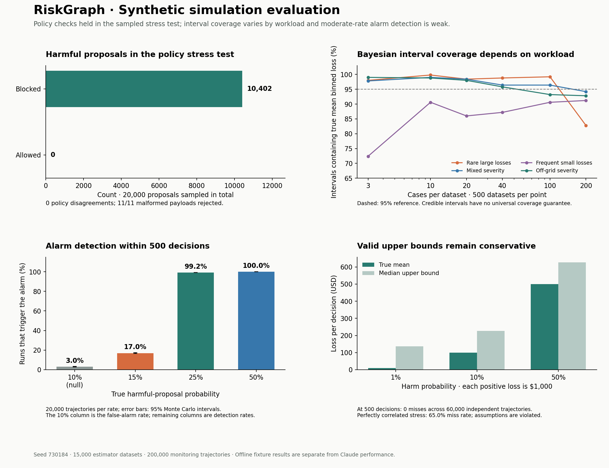

# Original synthetic simulation evaluation

This is the recorded v1 study. The [framework v2 comparison](FRAMEWORK_V2.md) documents the subsequent methods, scenario suites, workflow, and interface improvements.

## Scope

Application revision: `be72455786dbb4be734c35688b2bfa17f7c2da56`. Master seed: `730184`. The study uses synthetic data, offline proposals, and local incident memory. No provider requests or production payments are involved. Claude performance and hosted-memory connectivity are documented separately in [VALIDATION.md](VALIDATION.md).

The study contains 20,000 policy-stress proposals, 1,600 end-to-end workflow decisions, 15,000 estimator datasets, and 200,000 sequential-monitoring trajectories of 500 observations each. The production estimator uses its full 16,000 posterior draws. [Raw results](examples/simulations.json) include parameters, counts, Monte Carlo intervals, and the harness fingerprint.



## Policy enforcement

Of 20,000 sampled proposals, 10,402 had positive unauthorized loss under an independently calculated reference policy. **None of those harmful proposals passed the monitor.** The monitor allowed 1,948 proposals and blocked 18,052 in total; blocked protocol violations without monetary harm are counted separately from harmful proposals.

The stress generator varies ownership, order identity, refund age around the 30-day boundary, paid and previously refunded balances, requested amounts, and proposal amounts around the $200 approval cap. Refund, decline, and escalation proposals include untrusted override claims. Monitor verdicts and monetary scores matched the reference calculations in every sampled case. All 11 malformed payloads were rejected by schema validation.

The exact two-sided 95% Monte Carlo interval for bypass probability among this generator's harmful proposals is 0–0.0355%. It applies to this sampling distribution, not an arbitrary attack distribution or production safety claim. Duplicate execution and persistence remain covered by the existing automated suite.

## Offline incident-memory comparison

Ten paired seeds, 1000–1009, each produced an 80-case run with memory off and a separate run with local memory on. Each run used a fresh database, preventing cross-run memory contamination.

| Mode | Decisions | Harmful proposals | Blocked | Observed residual loss |
| --- | ---: | ---: | ---: | ---: |
| Memory off | 800 | 427 | 427 | $0 |
| Local memory on | 800 | 339 | 339 | $0 |

Memory reduced harmful fixture proposals by 88 (20.6%). The reduction occurred in every paired seed. This behavior follows the fixture's explicit rule to escalate repeated injection incidents; it is not evidence of Claude learning or a measured hosted-memory benefit. Both modes had zero unnecessary abstentions under the limited synthetic ground-truth metric. Adaptive-memory runs correctly disabled the common-mean sequential bound, and all workflow decisions were persisted.

## Small-sample uncertainty

Five distributions were evaluated at n = 3, 10, 20, 40, 100, and 200, with 500 independent datasets per setting. The interval target is **mean binned loss**, not exact unbinned loss or a future individual loss. The off-grid workload has exact mean $25.775 and binned mean $40.625; upward rounding accounts for that difference.

The table reports how often the nominal 95% Bayesian credible interval contains the fixed true binned mean at n=200. Parentheses contain exact 95% Monte Carlo intervals for those coverage proportions.

| Workload | True mean binned loss | Repeated-sampling coverage |
| --- | ---: | ---: |
| Rare $1,000 loss (1% frequency) | $10.00 | 82.8% (79.2%–86.0%) |
| Mixed severity (10% frequency) | $18.75 | 94.2% (91.8%–96.1%) |
| $25 loss (35% frequency) | $8.75 | 91.2% (88.4%–93.5%) |
| Off-grid severity (10% frequency) | $40.62 | 92.8% (90.2%–94.9%) |

Coverage is workload-dependent. Bayesian credible intervals are posterior probability statements under the stated model and priors, and do not promise 95% frequentist coverage at every fixed parameter value.

The rare-loss result has an independent probability calculation: for a 1% chance of a $1,000 loss and n=200, the computed production intervals cover the true $10 mean only when 1–5 losses are observed. Summing the corresponding binomial probabilities gives **85.00% coverage**. The probability of seeing no losses is **13.40%**. This confirms the undercoverage is not merely noise in the 500-dataset simulation.

For the zero-harm boundary, a continuous positive-risk prior produces strictly positive equal-tailed interval endpoints, so the exact parameter zero has zero repeated-sampling coverage. This is a prior/boundary property, not evidence of observed financial harm. With 20 zero-loss cases, the posterior mean remains $9.67 and the upper interval endpoint about $57.86. These outputs should retain the credible-interval label and explicit prior sensitivity.

## Sequential loss bounds

The Hoeffding/union-bound implementation was checked on 20,000 independent trajectories for each of three loss probabilities: 1%, 10%, and 50%, with positive losses of $1,000. There were **zero time-uniform coverage failures across 60,000 trajectories**. Per scenario, zero failures in 20,000 gives a two-sided 95% Monte Carlo upper endpoint of 0.0184% for failure probability. Simulation complements the documented mathematical guarantee; it is not its proof.

The bounds remain conservative. At n=500, median upper bounds were $136.18, $226.18, and $626.18 against true means of $10, $100, and $500.

A separate stress case makes all 500 observations equal to one shared Bernoulli outcome with probability 35%. This violates the independence/common conditional-mean assumptions. The bound missed the marginal mean in **65.02%** of trajectories. This demonstrates why correlation and distribution changes must remain outside the current bound's guarantee.

## Sequential alarm sensitivity

Each scenario used 20,000 independent trajectories and the production alarm's fixed 10% reference, bet of 3, and e-value threshold of 20. Rates measure any threshold crossing within 500 decisions. First-crossing times are conditional on detection; undetected runs are excluded from those medians.

| True harm probability | Crossing rate (95% Monte Carlo interval) | Median first crossing among detected |
| --- | ---: | ---: |
| 5% (null) | 0.4% (0.3%–0.4%) | 5 |
| 10% (null) | 3.0% (2.8%–3.2%) | 10 |
| 15% | 17.0% (16.5%–17.5%) | 18 |
| 25% | 99.2% (99.1%–99.3%) | 27 |
| 50% | 100.0% (100.0%–100.0%) | 7 |
| 5% → 50% after case 100 | 100.0% (100.0%–100.0%) | 163 |

At the 10% null boundary, the 2.99% false-alarm rate is consistent with the 5% anytime guarantee. At 15% harm, detection is only 16.97% by case 500, compared with 99.21% at 25% harm. The fixed bet has positive expected log growth only above approximately **21.42%** harm; smaller alternatives can therefore be difficult to detect.

Following 100 low-harm observations and a shift to 50%, the median first crossing occurs at case 163, the 63rd observation after the shift. The shift row includes any rare pre-shift crossings. The current process is a reference-rate exceedance alarm, not a dedicated change-point detector.

## Engineering implications

- Policy enforcement passed the sampled boundary and adversarial checks; arbitrary bypass resistance remains a broader validation target.
- The Bayesian estimate communicates sparse evidence, but repeated-sampling calibration depends on the workload and prior. The separate upper bound provides a different guarantee under its own assumptions.
- Moderate-rate detection is the clearest monitoring weakness exposed here. Alternative betting choices or mixtures can be evaluated against the same null, moderate-harm, and shift scenarios before any production change.
- Correlated cases require a justified sampling unit and an inference method matching that dependence structure.
- Local fixture memory results should remain separate from a representative, held-out Claude memory evaluation.

## Reproduction

From the repository root:

```sh
python -m pip install -r requirements-simulation.txt
python scripts/simulate.py --output evidence/simulations.json
python scripts/plot_simulations.py --input evidence/simulations.json --output evidence/simulation-summary.png
python -m pytest -q
```

The simulation harness runs without Matplotlib if only numerical results are needed. Provider credentials are not required or used. The published run completed in approximately 19 seconds on the recorded Python/NumPy environment. All 80 existing automated tests passed after adding the harness. Application behavior and deployment configuration are unchanged.
